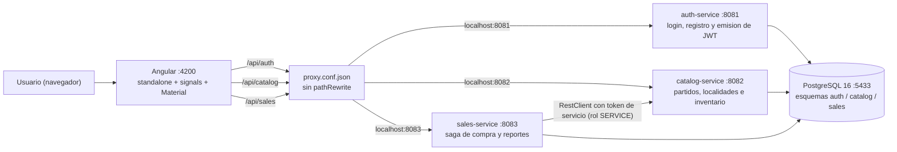
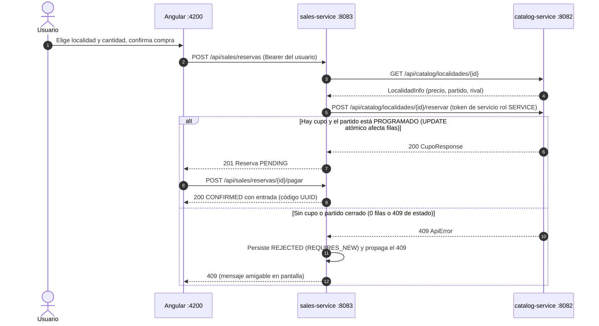

# Boletería Baloncesto Valle del Cauca

Prototipo de **sistema de boletería** para los partidos del equipo del Valle del Cauca:
los usuarios consultan los partidos, compran entradas con **pago simulado** y reciben un
código único; los administradores gestionan partidos, precios, cupos y reportan ventas.

**Stack:** Spring Boot 3.5.16 (Java 21) · Angular 22 (standalone + signals) ·
Angular Material 22 (MIT) · PostgreSQL 16 · Flyway · Spring Security + JWT · Testcontainers ·
Springdoc (Swagger).

## Estado: qué está implementado

- [x] **3 microservicios** Spring Boot (auth, catalog, sales) con esquemas de BD propios.
- [x] **Consulta pública de partidos** con filtros opcionales por fecha y estado, detalle con
      localidades, precios y disponibilidad en vivo.
- [x] **Flujo de compra completo**: reserva → pago simulado → entrada con código UUID único;
      409 amigable cuando no hay cupo; cancelación con liberación de cupo.
- [x] **Control de inventario sin sobreventa** (caso crítico): `UPDATE` atómico condicional
      + `CHECK` en BD + tests multihilo contra PostgreSQL real (ver sección dedicada).
- [x] **Panel ADMIN**: CRUD de partidos y localidades, edición de precios/cupos, cancelación
      lógica de partido con liberación masiva de cupos y **reporte de ventas** (Native Query).
- [x] **JWT + roles USER/ADMIN** validados en el backend de **cada** servicio; errores
      401/403 en formato `ApiError` uniforme. El inventario interno (`reservar/liberar`) solo
      acepta un **token de servicio** (`rol=SERVICE`, 60 s) firmado por sales.
- [x] **Reservas sin pago expiran** (job programado) y devuelven el cupo; carreras de pago y
      cancelación resueltas con bloqueo optimista (`@Version` → 409).
- [x] **Pruebas automatizadas**: **35 tests backend** (Testcontainers/Postgres 16) + **57 tests**
      de frontend (Vitest, 11 archivos).
- [x] **Swagger** en los 3 servicios y **script de demostración de concurrencia**.

---

## Arquitectura



### Responsabilidades de cada servicio

| Servicio | Puerto | Responsabilidad | Esquema BD |
|---|---|---|---|
| `auth-service` | 8081 | Registro (BCrypt), login y **emisión** del JWT HS256. Es el único emisor del token. | `auth` |
| `catalog-service` | 8082 | Catálogo público de partidos y localidades. Es el **dueño del inventario** (cupo/vendidos): expone el endpoint `reservar/liberar` que implementa la anti-sobreventa. | `catalog` |
| `sales-service` | 8083 | Orquesta la **saga de compra** (reserva → pagar → cancelar), persiste reservas y entradas, y sirve el reporte de ventas. No es dueño del cupo. | `sales` |
| `frontend` | 4200 | Angular standalone con signals, Angular Material 22 y sistema de diseño propio (rojo/blanco del Valle). El dev-server actúa de proxy hacia los 3 servicios. | — |

### Cómo se comunican

- **Angular → servicios:** el navegador solo ve `/api/...`; `frontend/proxy.conf.json` reenvía
  `/api/auth` → :8081, `/api/catalog` → :8082 y `/api/sales` → :8083 **sin pathRewrite**
  (los servicios ya exponen el prefijo completo).
- **sales → catalog:** REST **síncrono** con el `RestClient` de Spring Boot (sin Feign ni
  Spring Cloud). sales firma un **token de servicio** corto (`sub=sales-service`,
  `rol=SERVICE`, 60 s) con el mismo secreto compartido y lo envía en la cabecera
  `Authorization`; catalog exige ese rol SOLO en `reservar/liberar`. El JWT del usuario no
  viaja entre servicios: cada uno valida su propia frontera.
- **auth → el resto:** auth emite el JWT (`sub` = email, claim `rol`, 8 h de validez) y los
  **3 servicios lo validan con el mismo secreto** (`JWT_SECRET`), por lo que cualquiera
  verifica el token sin llamar a auth.
- **Sin API Gateway:** decisión deliberada del diseño; con la red interna de Docker y el
  proxy de Angular no hace falta un punto único de entrada, y cada servicio valida sus
  propias reglas de rol (`hasRole`). Si el sistema creciera, el gateway sería el siguiente
  paso natural.

---

## Requisitos previos

| Requisito | Versión | Notas |
|---|---|---|
| JDK | 21 | Compilación y arranque de los servicios. |
| Docker + Compose | cualquier versión reciente | PostgreSQL 16 y, opcionalmente, los 3 servicios en contenedor. Los tests usan Testcontainers → el daemon debe estar levantado. |
| Node.js | 20+ (probado con 24) | Build y tests del frontend. |
| Maven | **no se instala** | Se usa el wrapper del repo: `.\mvnw.cmd`. |

> **Puerto de PostgreSQL:** el contenedor del compose expone **5433 en el host** (la 5432
> suele estar ocupada por otro Postgres); dentro de la red Docker el servicio escucha en
> 5432. Los `application.yml` apuntan por defecto a `jdbc:postgresql://localhost:5433/boleteria`.

---

## Variables de entorno

Todas son opcionales en desarrollo: los valores por defecto (de los `application.yml` y del
compose) permiten arrancar sin configurar nada.

| Variable | Descripción | Default local | En Docker (compose) |
|---|---|---|---|
| `DB_URL` | URL JDBC de PostgreSQL | `jdbc:postgresql://localhost:5433/boleteria` | `jdbc:postgresql://postgres:5432/boleteria` |
| `DB_USER` | Usuario de PostgreSQL | `boleteria` | `boleteria` |
| `DB_PASSWORD` | Contraseña de PostgreSQL | `boleteria` | `boleteria` |
| `JWT_SECRET` | Secreto HS256, **≥ 32 bytes** (lo comparten los 3 servicios) | `demo-secret-para-jwt-hs256-de-32-bytes!!` | `c2VjcmV0LWRlbS1ibGV0ZXJpYS1jb2RpZ28tMzItYnl0ZXMtcGFyYS1ocy0yNTY` |
| `SALES_CATALOG_URL` | URL de catalog **solo para sales-service** | `http://localhost:8082` | `http://catalog-service:8082` |
| `SALES_RESERVAS_EXPIRACION_MINUTOS` | Minutos que una reserva `PENDING` puede esperar el pago antes de expirar | `10` | `10` |
| `SALES_RESERVAS_EXPIRACION_INTERVALO_MS` | Intervalo del job que expira reservas `PENDING` | `60000` | `60000` |

En un entorno real: secreto propio por entorno y credenciales de BD distintas; el arranque
falla de forma explícita si `JWT_SECRET` tiene menos de 32 bytes.

---

## Cómo ejecutar

### Opción A — Desarrollo (recomendada)

1. **PostgreSQL** en contenedor (desde la raíz del repo):

   ```powershell
   docker compose -f infra/docker-compose.yml up -d
   ```

2. **Los 3 servicios**, cada uno en su terminal (desde la raíz; la primera vez conviene
   instalar el módulo `common` en el repositorio local con
   `.\mvnw.cmd -B -pl backend/common install "-DskipTests"`):

   ```powershell
   .\mvnw.cmd -B -pl backend/auth-service spring-boot:run     # :8081
   .\mvnw.cmd -B -pl backend/catalog-service spring-boot:run  # :8082
   .\mvnw.cmd -B -pl backend/sales-service spring-boot:run    # :8083
   ```

   Cada servicio aplica sus migraciones Flyway al arrancar (esquema + datos de ejemplo).

3. **Frontend** (cuarta terminal):

   ```powershell
   cd frontend
   npm install
   npx ng serve
   ```

4. Abrir **http://localhost:4200**.

### Opción B — Stack completo en Docker

```powershell
docker compose -f infra/docker-compose.yml --profile full up --build
```

Levanta PostgreSQL + auth + catalog + sales (perfiles `full` del compose, imágenes
multi-paso con `infra/Dockerfile`). El frontend se sirve igualmente con `npx ng serve`
(o con `npx ng build` para un artefacto estático).

### Datos de ejemplo (semilla Flyway V2)

| Usuario | Contraseña | Rol |
|---|---|---|
| `admin@valle.test` | `admin123` | ADMIN |
| `usuario@valle.test` | `usuario123` | USER |

Catálogo (fechas relativas a `CURRENT_DATE`, el seed es idempotente):

| Partido | Fecha | Localidades |
|---|---|---|
| Caimanes de Barranquilla | +7 días | General (cupo 100), Prensa (40), **VIP con cupo 1** ← la "última entrada" del caso crítico |
| Soacha Búfalos | +14 días | General (100), Prensa (40), VIP (20) |
| Pilares de Yumbo | +3 días | General (100), Prensa (40), VIP (20) |

### Demostración de concurrencia (script)

Con el stack corriendo:

```powershell
node infra/demo-concurrencia.mjs        # N=10 peticiones por defecto
node infra/demo-concurrencia.mjs 20     # N personalizado
```

Script en Node puro (fetch nativo, cero dependencias): inicia sesión como
`usuario@valle.test` / `usuario123` (credenciales configurables por variables de entorno),
elige la localidad con menos disponibles > 0, dispara **N `POST /api/sales/reservas` en
paralelo** e imprime éxitos (201) vs conflictos (409) y la disponibilidad final. Con la
localidad VIP de cupo 1 espera: **1 éxito / N-1 conflictos**.

---

## Qué está fuera de alcance

- **Pasarela de pago real**: el pago es simulado por requisito de la prueba.
- **API Gateway**: cada servicio valida su JWT (decisión documentada en Arquitectura).
- **Refresh token**: los tokens duran 8 h; no hay renovación.
- **Deploy en la nube**: la entrega se ejecuta en local (Docker).
- **Tests e2e de navegador**: la verificación end-to-end es manual; el frontend tiene unit
  tests con Vitest.
- **Rate limiting** en login/registro y tope por usuario en `/reservas` (la expiración de PENDING
  evita que un usuario retenga cupo indefinidamente).
- **Saga distribuida / outbox** para la cancelación de partido: se orquesta desde el cliente
  (ver "Límites conocidos y decisiones").

---

## Pruebas

Requisito: Docker corriendo (Testcontainers levanta **PostgreSQL 16 real** por módulo).

### Backend — 35 tests

```powershell
.\mvnw.cmd -B test
```

| Módulo | Tests | Qué cubre |
|---|---|---|
| `auth-service` | 9 (6 integración + 3 unitarios) | Registro → login → `/yo`; email duplicado → 409 con `ApiError`; login malo → 401; `/yo` sin token → 401; login del admin seed; body inválido → 400. Unitarios del `JwtService`: claims, firma con otro secreto rechazada, secreto < 32 bytes falla. |
| `catalog-service` | 14 (11 controller + 2 repositorio + 1 concurrencia) | Listado público con filtro de fecha; detalle 404; localidad pública; escrituras 401/403/201 según rol; **reservar/liberar solo con rol SERVICE** (USER y ADMIN → 403; token sin rol → 401); flujo reservar/liberar y 409 sin cupo; **partido CANCELADO no admite reservar (409)**; partido sin hora/escenario → 400; cupo no editable por debajo de lo vendido. Repositorio: JPQL de filtros (fecha, estado, ambas) y semilla de la última entrada. |
| `sales-service` | 12 (7 flujo + 1 concurrencia compra + 2 concurrencia reserva + 2 expiración) | Saga completa reserva→pagar→entrada; sin cupo → 409 y reserva REJECTED; cancelar libera cupo; permisos de pago/cancelación/reporte; cancelación masiva por partido; reporte nativo agrupa solo CONFIRMED; dos pagos no producen códigos repetidos; **dos pagos/cancelaciones simultáneos → 409 y una sola entrada**; **PENDING viejas expiran y liberan cupo**. |

Pruebas estrella del caso crítico:

- **`ConcurrenciaCupoTest`** (catalog): 10 hilos con barrera de largada reserva 1 entrada
  sobre una localidad de **cupo 1** en Postgres real → exactamente **1 éxito,
  9 `ConflictException` y `vendidos == 1`**.
- **`ConcurrenciaCompraTest`** (sales): 10 hilos ejecutan el flujo completo
  (reserva → pagar) contra cupo 1 → **1 reserva CONFIRMED + 9 REJECTED, exactamente 1
  entrada emitida** y jamás un 5xx (el cupo se replica con un CAS en el mock de catalog).

### Frontend

```powershell
cd frontend
npx ng test --watch=false
```

Suite unitaria con **Vitest** (Angular 22 ya no usa Karma): servicios, guards, componentes y
el flujo de compra, con **57 tests en 11 archivos** en verde.

**Diseño (valor agregado):** identidad deportiva **rojo/blanco** del Valle del Cauca con tokens
en `styles.scss` (sombras con offset vertical, superficies sin bordes, acentos rojos y jerarquía
de botones sólido/outline/texto, según los 7 tips de Refactoring UI), tipografía
**Barlow Condensed + Barlow** con fallback a fuentes del sistema, y **Angular Material 22** en las
pantallas de acceso (`mat-form-field`, `mat-flat-button`). El botón de compra se deshabilita si el
partido no está `PROGRAMADO` (y el backend también lo rechaza con 409).

---

## Caso crítico: estrategia de concurrencia (la "última entrada")

**Problema:** N clientes persiguen la última entrada de una localidad. Nadie debe poder
comprar dos veces la misma unidad, y el sistema no puede bloquearse ni perder consistencia.

### Mecanismo principal: UPDATE atómico condicional

El inventario vive en `catalog` (dueño de la localidad) y la reserva de cupo es **una sola
sentencia SQL condicionada** (`LocalidadRepository.sumarVendidos`):

```sql
UPDATE catalog.localidades
   SET vendidos = vendidos + :cantidad
 WHERE id = :id AND vendidos + :cantidad <= cupo
```

- Si la consulta **afecta filas** → había cupo: reservado.
- Si **afecta 0 filas** → no había cupo: el servicio lanza `ConflictException` → **HTTP 409**.

PostgreSQL toma un *row lock* sobre la fila; en `READ COMMITTED`, al liberarse el lock
REEVALÚA el `WHERE` contra el valor ya commitado. De N transacciones simultáneas peleando
por el último cupo, **solo una** afecta filas. No hay lectura previa en Java, no hay
*check-then-act* y no hay locks de aplicación.

La liberación (compensación) usa la misma técnica con piso en cero:
`SET vendidos = vendidos - :cantidad WHERE id = :id AND vendidos >= :cantidad`.

### Capas adicionales (defensa en profundidad)

| Capa | Dónde | Función |
|---|---|---|
| `CHECK (vendidos >= 0 AND vendidos <= cupo)` | `V1__init_catalogo.sql` (catalog) | Red de seguridad final: aunque un futuro camino esquivara el UPDATE, la BD rechaza la sobreventa. |
| `UNIQUE (codigo_unico)` | `sales.entradas` | Garantía física de códigos de entrada no repetidos (UUID v4). |
| `UNIQUE (reserva_id)` | `sales.entradas` | Exactamente **una entrada por reserva**. |
| `@Version` en `Reserva` | `sales.reservas` (migración V3) | Serializa pagos/cancelaciones simultáneos sobre la MISMA reserva: el perdedor recibe **409**, nunca un 500. |
| Transacción `REQUIRES_NEW` | sales (trazabilidad) | La reserva REJECTED se persiste en una transacción independiente para no perderla con el rollback del 409. |

### Saga de compra en sales-service

1. **Reservar** (`POST /api/sales/reservas`): sales lee el snapshot de catalog
   (precio/partido/rival) y le pide el cupo (`POST .../reservar`, `RestClient` con un
   **token de servicio** `rol=SERVICE`). Catalog rechaza con 409 si no hay cupo **o si el
   partido no está PROGRAMADO** (cancelado/jugado no se vende). Si catalog responde 409,
   sales persiste la reserva `REJECTED` con `REQUIRES_NEW` (trazabilidad) y propaga el
   409; si todo va bien, guarda la reserva `PENDING`.
2. **Pagar** (`POST .../pagar`, dueño): pago simulado; reserva y **entrada con código UUID
   se confirman en la MISMA transacción** (`PENDING → CONFIRMED`): o ambas quedan en BD o
   ninguna.
3. **Cancelar** (`POST .../cancelar`, dueño o ADMIN): `PENDING/CONFIRMED → CANCELLED` y
   **compensación** — se libera el cupo en catalog (`POST .../liberar`). La cancelación
   masiva por partido (`POST .../cancelar-por-partido/{id}`, ADMIN) repite la compensación
   por cada reserva viva.
4. **Expiración** (job programado cada 60 s): las reservas `PENDING` con más de
   `sales.reservas.expiracion.minutos` (10 por defecto) se cancelan y liberan su cupo; el
   barrido es transaccional y reintenta en la pasada siguiente si catalog falla. Sin esto,
   una reserva sin pago retendría el cupo para siempre.

### Alternativas consideradas

| Estrategia | Mecanismo | Ventajas | Limitaciones |
|---|---|---|---|
| Optimista (`@Version`) | JPA compara la versión al guardar; si otra transacción ganó, `OptimisticLockException` | Estándar JPA, cero SQL a mano | Exige un **bucle de reintentos** en la saga; con N clientes por la última entrada, casi todos reintentan para nada; el error al usuario no es determinista |
| Pesimista (`SELECT ... FOR UPDATE`) | Bloqueo de fila explícito antes de leer y escribir | Garantía fuerte y fácil de razonar | **Bloquea la fila** durante toda la transacción; contención y tiempos de espera; escala peor |
| **Atómico condicional (elegido)** | Un `UPDATE ... WHERE vendidos + :cantidad <= cupo` | Simple, una sentencia, **sin locks largos ni reintentos**, correcto bajo cualquier nivel de concurrencia y verificable con un assert exacto en tests | Menos "declarativo JPA" (es un `@Modifying`); el estado intermedio no es observable — irrelevante aquí |

**Por qué esta decisión:** la condición de negocio ("no vender más que el cupo") viaja
dentro del propio `UPDATE`, así que el motor de base de datos la evalúa de forma atómica —
es la solución más simple que es **correcta por construcción**, no deja ventana de carrera
y no bloquea filas más allá del propio `UPDATE`, con evidencia directa en tests multihilo.

El `@Version` de JPA **sí** se usa, pero en las **reservas** (transiciones de estado
`PENDING → CONFIRMED/CANCELLED`), no en el inventario: ahí la condición de cupo necesita el
`UPDATE` atómico para no depender de reintentos.

### Evidencia verificable

1. `ConcurrenciaCupoTest` (catalog, 10 hilos, cupo 1, Postgres 16 real): 1 éxito / 9
   conflictos / `vendidos == 1`.
2. `ConcurrenciaCompraTest` (sales, 10 hilos, flujo completo): 1 CONFIRMED + 9 REJECTED,
   1 entrada emitida.
3. Script end-to-end contra el stack corriendo: `node infra/demo-concurrencia.mjs [N]`
   → imprime `1 éxito / N-1 conflictos` y la disponibilidad final.
4. `ConcurrenciaReservaTest` (sales, barrera): dos pagos simultáneos → **1 éxito + 1 conflicto
   y una sola entrada**; pagar vs cancelar → **nunca** queda CONFIRMED con el cupo liberado.
5. `ExpiracionPendientesTest` (sales): una PENDING envejecida se cancela y libera su cupo; las
   PENDING nuevas y las CONFIRMED quedan intactas.

---

## JPQL vs SQL nativo (identificación y justificación)

### JPQL parametrizada — `catalog` (filtros del listado)

`PartidoRepository.buscar` es **JPQL** y resuelve los filtros opcionales por fecha y estado:

```java
@Query("""
        SELECT DISTINCT p FROM Partido p
        LEFT JOIN FETCH p.localidades l
        WHERE (:estado IS NULL OR p.estado = :estado)
          AND (CAST(:fecha AS java.time.LocalDate) IS NULL OR p.fecha = :fecha)
        ORDER BY p.fecha ASC""")
List<Partido> buscar(@Param("estado") EstadoPartido estado, @Param("fecha") LocalDate fecha);
```

- Trabaja con **entidades**, es portable (cualquier JPA) y reutiliza el mapeo objeto-relacional
  ya declarado; el `LEFT JOIN FETCH` trae las localidades en la misma consulta (sin N+1).
- El `CAST(:fecha AS java.time.LocalDate)` es **obligatorio en Hibernate 6.6 + PostgreSQL**:
  sin él, el parámetro nulo viaja sin tipo declarado y PG responde el error `42P18
  "could not determine data type"`. El `CAST` fija el tipo DATE sin alterar la semántica del
  filtro opcional (el parámetro de enum no lo necesita).

También es JPQL la consulta `buscarPorUsuario` de sales ("mis reservas"), parametrizada con
estado opcional y `LEFT JOIN FETCH r.entrada` (anti-N+1): misma técnica y mismo `CAST` sobre
el parámetro anulable.

### SQL nativo — `sales` (reporte de ventas)

`ReservaRepository.reporteVentas` es una **Native Query** con agregaciones:

```sql
SELECT r.partido_id     AS "partidoId",
       r.rival_snapshot AS "rival",
       r.localidad_id   AS "localidadId",
       COALESCE(SUM(r.cantidad), 0) AS "cantidadVendida",
       COALESCE(SUM(r.total), 0)    AS "totalRecaudado"
  FROM sales.reservas r
 WHERE r.estado = 'CONFIRMED'
   AND (CAST(?1 AS BIGINT) IS NULL OR r.partido_id = ?1)
 GROUP BY r.partido_id, r.rival_snapshot, r.localidad_id
 ORDER BY r.partido_id, r.localidad_id
```

- Es un reporte con **`SUM` + `GROUP BY` sobre columnas desnormalizadas** (`partido_id`,
  `rival_snapshot`, `localidad_id`) dentro del esquema `sales`. En JPQL sería engorroso:
  habría que joinar contra la entidad `Entrada` para validar la emisión y proyectar agregados
  condicionales mezclando estructuras de clases.
- El **snapshot desnormalizado** (`rival` congelado en el momento de la reserva) evita joins
  entre esquemas — decisión de **propiedad de datos**: cada esquema se resuelve solo, y un
  cambio posterior del catálogo no altera el histórico de ventas.
- La proyección por interfaz con alias de columna (`AS "partidoId"`) traduce 1:1 los nombres
  del contrato JSON. El `CAST(?1 AS BIGINT)` cubre el filtro opcional `?partidoId=`.

---

## Índices y restricciones

| Índice / restricción | Dónde | Por qué |
|---|---|---|
| `idx_partidos_fecha_estado (fecha, estado)` | `catalog.partidos` | Acelera el filtro de la JPQL del listado público. |
| `idx_localidades_partido (partido_id)` | `catalog.localidades` | FK que se une en cada listado/detalle de partidos. |
| `idx_reservas_usuario (usuario_email)` | `sales.reservas` | "Mis reservas" filtra por el usuario autenticado. |
| `idx_reservas_localidad_estado (localidad_id, estado)` | `sales.reservas` | Agregados por localidad y filtrado por estados vivos. |
| `idx_reservas_partido (partido_id)` | `sales.reservas` | Reporte por partido y cancelación masiva tras cancelar un partido. |
| `CHECK (vendidos >= 0 AND vendidos <= cupo)` | `catalog.localidades` | Red de seguridad anti-sobreventa (capa 2). |
| `CHECK (precio > 0)`, `CHECK (cupo >= 1)` | `catalog.localidades` | Integridad de precios y cupos. |
| `CHECK (estado IN (...))` | `catalog.partidos`, `sales.reservas` | Estados válidos a nivel de BD. |
| `UNIQUE (email)` | `auth.usuarios` | Identidad única para login (emails normalizados a minúsculas). |
| `UNIQUE (codigo_unico)` | `sales.entradas` | Códigos de entrada nunca repetidos. |
| `UNIQUE (reserva_id)` | `sales.entradas` | Exactamente 1 entrada por reserva. |
| `FK localidades.partido_id`, `entradas.reserva_id` | catálogo y ventas | Integridad referencial dentro de cada esquema (sin joins entre esquemas). |

---

## Seguridad

- **JWT HS256** (jjwt) emitido por auth-service: claims `sub` = email y `rol`; **validez 8 h**.
- El **mismo secreto** (`JWT_SECRET`) lo comparten los 3 servicios: auth firma, catalog y
  sales validan sin llamar a auth.
- **Roles USER/ADMIN validados EN CADA SERVICIO** (`SecurityConfig` con `hasRole`): escrituras
  del catálogo y reporte/cancelación masiva → solo ADMIN; ventas → autenticado; **inventario
  (`reservar`/`liberar`) → solo rol `SERVICE`** (token corto firmado por sales; ni USER ni
  ADMIN pueden moverlo directamente).
- **Endpoints públicos:** `GET` de catálogo (listado/detalle/localidades), login y registro,
  y la documentación Swagger (`/v3/api-docs/**`, `/swagger-ui/**`, `/swagger-ui.html`).
- **401/403 en formato `ApiError`** uniforme (del módulo `common`) vía `AuthenticationEntryPoint`
  y `AccessDeniedHandler`, no páginas de error del contenedor.
- **Contraseñas con BCrypt** (strength 10); los usuarios registrados por API nacen siempre
  `USER` (el ADMIN solo viene del seed).

### Límites conocidos y decisiones (alcance de la prueba)

- **Cancelación de partido orquestada en el cliente** (panel admin): Angular llama primero a
  catalog (`PUT /partidos/{id}/cancelar`) y después a sales (`cancelar-por-partido`). No hay
  saga distribuida ni transacción entre servicios: si la pestaña se cierra entre ambos pasos, el
  partido queda cancelado en catalog y las reservas vivas hasta que el admin repita la acción
  (el segundo paso es idempotente y el panel avisa del reintento). Se eligió así para no
  introducir un coordinador (outbox/saga) fuera del alcance de la prueba.
- **Garantía de concurrencia**: la prueba fuerte vive en `ConcurrenciaCupoTest` (catalog, Postgres
  real) y en el script end-to-end (`infra/demo-concurrencia.mjs`); el test de sales usa un mock con
  CAS para aislar la lógica de la saga y las carreras de estado.
- **Ventana conocida**: si catalog toma el cupo y el `save` de la reserva falla (p. ej. BD caída),
  el cupo queda tomado hasta la cancelación masiva del partido; está documentado en el código.
- **`JWT_SECRET`**: el `application.yml` trae un valor de demo para arrancar sin configuración; en
  producción es obligatorio definirlo por entorno. Swagger queda público a propósito (lo evalúa la
  prueba).
- **Sin rate limiting** en login/registro ni tope por usuario en `/reservas` (fuera de alcance);
  la expiración de PENDING evita que un usuario retenga cupo indefinidamente.
- CORS abierto solo porque es un demo; en producción se restringiría al origen del frontend.

---

## Estructura del repositorio

```
basket/
├── backend/
│   ├── common/                 # ApiError, GlobalExceptionHandler, JwtService (usuario y servicio), DTOs
│   ├── auth-service/           # :8081 — esquema auth
│   ├── catalog-service/        # :8082 — esquema catálogo + inventario (caso crítico)
│   └── sales-service/          # :8083 — esquema ventas + saga + Native Query
├── frontend/                   # Angular 22 standalone + signals + Material 22 (proxy a los 3 servicios)
├── infra/
│   ├── docker-compose.yml      # PostgreSQL 16 (:5433) + servicios con --profile full
│   ├── Dockerfile              # build multi-paso parametrizado con --build-arg MODULE
│   └── demo-concurrencia.mjs   # N peticiones HTTP paralelas sobre la última entrada
├── pom.xml                     # reactor Maven (Spring Boot 3.5.16, Java 21)
├── mvnw.cmd                    # wrapper de Maven (no requiere instalación)
├── PLAN.md                     # plan de trabajo y estado real de cada bloque
└── memory.md                   # decisiones cerradas y lecciones aprendidas
```

### Secuencia de una compra



---

## Swagger (Springdoc)

Cada servicio publica su OpenAPI:

| Servicio | Swagger UI |
|---|---|
| auth-service | http://localhost:8081/swagger-ui.html |
| catalog-service | http://localhost:8082/swagger-ui.html |
| sales-service | http://localhost:8083/swagger-ui.html |

---

_Autor: 10carabal · Octubre de 2026 · Prueba técnica CODESA (desarrollador full stack), plazo 4 días._
